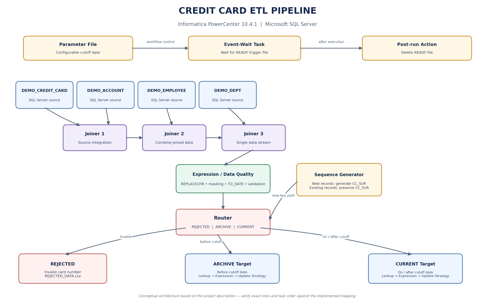

# End-to-End Credit Card ETL Pipeline (Informatica PowerCenter & SQL Server)

An enterprise-grade ETL pipeline built using **Informatica PowerCenter 10.4.1** and **Microsoft SQL Server**. The pipeline extracts messy credit card and customer data from multiple relational tables, applies data cleansing, PII masking, and date standardization, and routes records dynamically into **CURRENT**, **ARCHIVE**, and **REJECTED** destinations using SCD Type 1 (Upsert) logic and event-driven orchestration.

---

## Architecture Overview



### Data Flow Summary:
1. **Sources (SQL Server):** `DEMO_DEPT`, `DEMO_EMPLOYEE`, `DEMO_ACCOUNT`, `DEMO_CREDIT_CARD`.
2. **Integration & Cleansing:** 3 Joiner transformations combine the 4 tables, followed by an Expression transformation for whitespace removal, PCI-DSS compliant masking, multi-format date parsing, and length validation.
3. **Routing:** A Router transformation splits the stream based on card validity and a dynamic `$$CUTOFF_DATE` parameter.
4. **Upsert & Key Management:** Connected Lookups check existing records in target tables, Update Strategies flag rows for `DD_INSERT` or `DD_UPDATE`, and a Sequence Generator assigns persistent Surrogate Keys (`CC_SUR`) only to new records.
5. **Orchestration:** Triggered via an **Event-Wait** task watching for a ready file, which is automatically cleaned up post-execution.

---

## Repository Structure

```text
Informatica-Credit-Card-ETL-Pipeline/
│
├── README.md
├── mappings/
│   ├── mapping_overview.png
│   └── mapping_description.md
├── workflows/
│   └── workflow_overview.png
├── sql/
│   ├── create_source_tables.sql
│   ├── create_target_tables.sql
│   ├── insert_sample_data.sql
│   └── validation_queries.sql
├── parameter_files/
│   └── parameter_file_example.txt
├── test_results/
│   ├── archive_results.png
│   ├── current_results.png
│   └── rejected_results.png
└── docs/
    └── project_architecture.png
